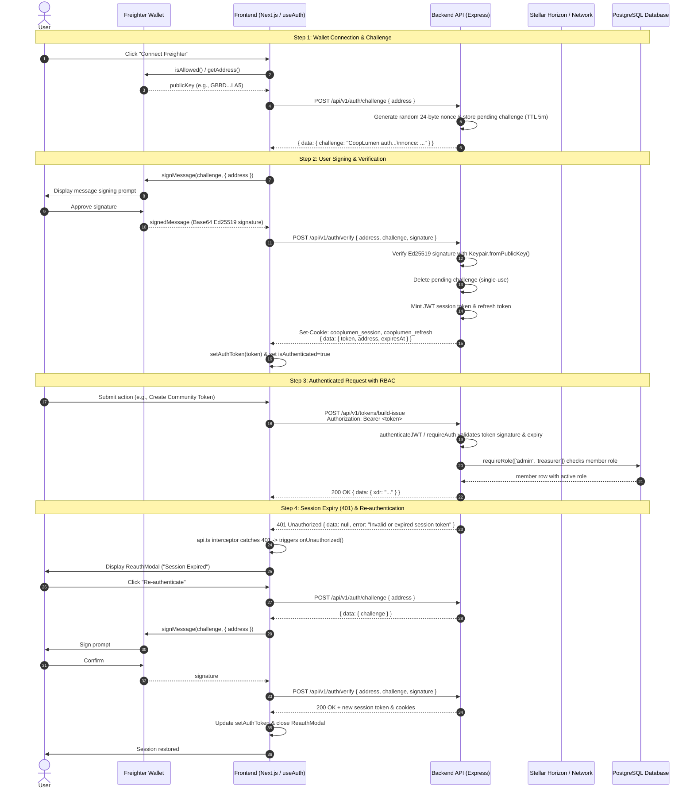
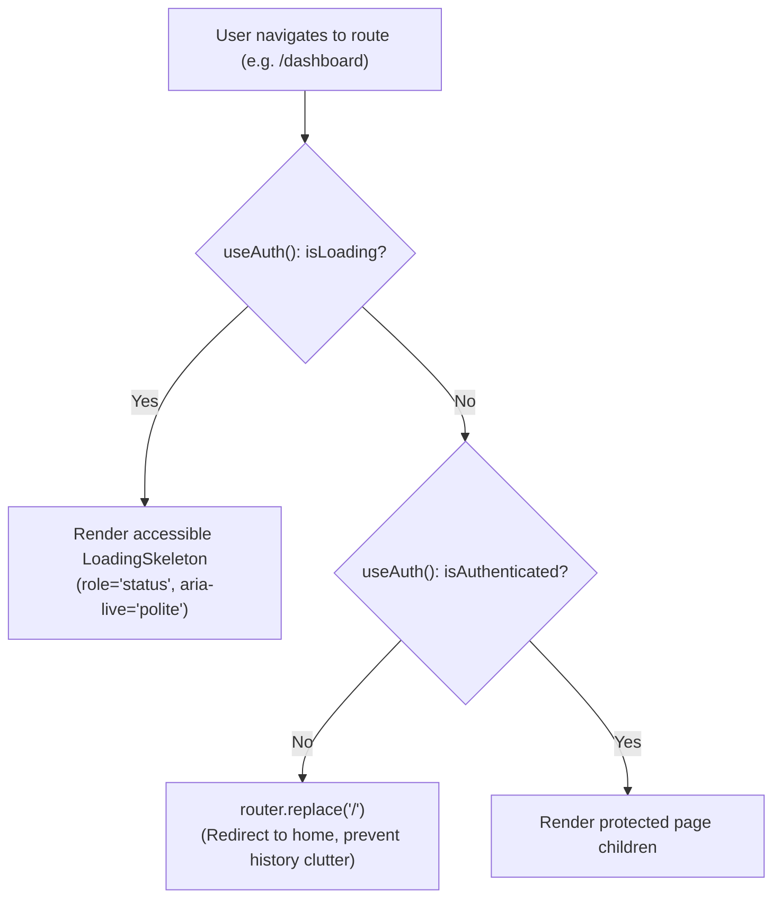

# Wallet-Based Authentication Flow & Architecture

This document describes CoopLumen's wallet-based authentication architecture, from Freighter wallet connection and cryptographic challenge signing to backend JWT session verification, role-based access control (RBAC), automatic 401 re-authentication, and client-side route protection.

---

## Architecture Overview

CoopLumen employs a **non-custodial, wallet-based challenge-response authentication scheme** powered by the Stellar network and the Freighter browser extension:

1. **Non-Custodial**: The backend never sees, handles, or stores user private keys. Proof of ownership is established purely via Ed25519 cryptographic signatures verified with `@stellar/stellar-sdk`'s `Keypair`.
2. **Short-Lived Challenges**: Nonces and challenge payloads expire in 5 minutes (`CHALLENGE_TTL_MS = 5 * 60 * 1000`) and are consumed upon verification, preventing replay attacks.
3. **Session Tokens**: Upon successful signature verification, the backend mints a short-lived HMAC-signed JWT session token, stored in an `httpOnly`, `SameSite=Strict` cookie (`cooplumen_session`, `Secure` in production) and returned in the JSON envelope for Bearer token authorization (`Authorization: Bearer <token>`).
4. **Token Refresh**: A companion rotated refresh token (`cooplumen_refresh` cookie) enables silent session refresh via `POST /api/v1/auth/refresh`.
5. **Backend RBAC Guarding**: Write endpoints enforce identity via `authenticateJWT` / `requireAuth` and authorization via `requireRole(['admin', 'treasurer', 'member', 'observer'])`, failing closed on unauthorized or out-of-role requests.
6. **401 Interceptor & Re-Authentication**: The frontend API client interceptor (`requestRaw` in `lib/api.ts`) detects HTTP 401 Unauthorized responses and triggers `ReauthModal` through `AuthProvider`, allowing users to re-sign and restore their session without losing form progress or navigating away.
7. **Client-Side Route Protection**: `ProtectedRoute` checks session state from `useAuth()`, displays an accessible skeleton during loading, redirects unauthenticated requests to `/`, and renders children when authenticated.

---

## Detailed Step-by-Step Flow

### 1. Challenge Issuance

- **Trigger**: User connects wallet or initiates login (`useWallet.ts` / `useAuth.tsx`).
- **Endpoint**: `POST /api/v1/auth/challenge` with body `{ address: "<publicKey>" }` (or `GET /api/v1/auth/challenge/:publicKey`).
- **Backend Operation**: Generates a cryptographically random 24-byte hex nonce and records an in-memory `PendingChallenge` mapping the public address to the challenge with a 5-minute expiration timestamp.
- **Challenge Message Format**:
  ```text
  CoopLumen authentication request
  address: <Stellar StrKey>
  nonce: <24-byte hex string>
  ```

### 2. Client-Side Challenge Signing

- **Trigger**: Frontend receives the challenge string.
- **Action**: Calls Freighter's `signMessage(challenge, { address })` from `@stellar/freighter-api`.
- **User Experience**: Freighter displays an approval prompt showing the plaintext message. The user approves using their local private key.
- **Output**: Base64-encoded Ed25519 signature.

### 3. Verification & Session Token Minting

- **Endpoint**: `POST /api/v1/auth/verify`
- **Request Body**:
  ```json
  {
    "address": "GBBD47IF6LWK7P7MDEVSCWR7DPUWV3NY3DTQEVFL4NAT4AQH3ZLLFLA5",
    "challenge": "CoopLumen authentication request\naddress: ...\nnonce: ...",
    "signature": "<base64 signature>"
  }
  ```
- **Backend Verification**:
  1. Validates that the challenge exists in `pendingChallenges` for the address and is unexpired.
  2. Deletes the pending challenge immediately (single-use replay protection).
  3. Uses `Keypair.fromPublicKey(address).verify(Buffer.from(challenge, 'utf8'), Buffer.from(signature, 'base64'))`.
  4. If verification fails, rejects with HTTP 401 `{ data: null, error: "Invalid signature" }`.
  5. If valid, generates an HMAC-signed session token (`createSessionToken`) and refresh token (`issueRefreshToken`).
  6. Sets `cooplumen_session` and `cooplumen_refresh` httpOnly cookies, and returns `{ data: { token, address, expiresAt } }`.

### 4. Client State Storage & Bearer Header Injection

- **Frontend Action**: `useWallet` / `AuthProvider` sets the token via `setAuthToken(token)`.
- **Outgoing Requests**: `api.ts` checks `config.getAuthToken()` and injects `Authorization: Bearer <token>` onto authenticated requests.

### 5. Backend RBAC Verification

- **Middleware**:
  - `authenticateJWT` / `requireAuth`: Reads token from `cooplumen_session` cookie or `Authorization: Bearer` header, verifies HMAC signature, checks expiry, and sets `req.auth = { address }`.
  - `requireRole(roles)`: Queries database for active membership in `:id` community (`SELECT role FROM members WHERE community_id = $1 AND stellar_address = $2 AND deleted_at IS NULL`). Rejects with 401 if unauthenticated, 403 if role is not permitted or member is inactive, and proceeds to controller if allowed.

### 6. Session Expiration & 401 Re-Authentication Flow

- **Trigger**: When an authenticated request fails with HTTP 401 (e.g. token expired after inactivity).
- **Interceptor**: In `frontend/src/lib/api.ts`, `requestRaw` invokes `config.onUnauthorized?.()`.
- **Modal Display**: `AuthProvider`'s subscriber sets `isReauthOpen = true`.
- **User Re-Authentication**: `ReauthModal` prompts user to re-sign with Freighter. On clicking "Re-authenticate", `reauthenticate()` requests a new challenge, prompts Freighter signing, verifies with backend, updates `setAuthToken`, and closes the modal without page reload.

---

## Authentication Sequence Diagram



---

## Route Protection & Client Navigation

Client routes requiring authentication are wrapped in the `<ProtectedRoute>` component:



---

## Security Invariants

| Invariant                       | Implementation Mechanism                                                                                    | Verification / Test                                                    |
| :------------------------------ | :---------------------------------------------------------------------------------------------------------- | :--------------------------------------------------------------------- |
| **No Private Key Transmission** | Wallet signing happens entirely in Freighter extension via `signMessage`.                                   | Verified: API schemas accept only public address and signature string. |
| **Challenge Replay Protection** | 5-minute TTL; challenges removed from `pendingChallenges` upon first verification attempt.                  | Unit tested in `backend/src/api/routes/__tests__/auth.test.ts`.        |
| **Safe Error Handling**         | No private keys, seed phrases, or JWT secrets are ever logged or included in API error envelopes.           | Unit tested in `ReauthModal.test.tsx` and `ProtectedRoute.test.tsx`.   |
| **Fail-Closed RBAC**            | `requireRole` with an empty or non-matching role list strictly fails with HTTP 403.                         | Unit tested in `backend/src/api/middleware/__tests__/auth.test.ts`.    |
| **HttpOnly Cookie Protection**  | Tokens are stored in `httpOnly`, `SameSite=Strict`, `Secure` (in prod) cookies to prevent XSS exfiltration. | Verified in `authCookie.ts` and `refreshToken.ts`.                     |
| **Accessible Dialogs**          | Focus trap, escape-key closing, ARIA role `dialog`, aria-modal, and aria-describedby on reauth modal.       | Tested in `ReauthModal.test.tsx`.                                      |
